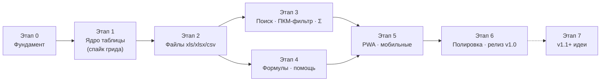
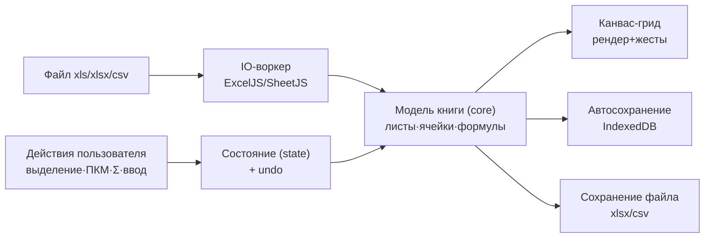

# NovaGrid — Карта создания

Версия: 1.0 (на согласование) · Дата: 2026-10-06

Документ отвечает на вопрос «**что за чем будем делать**». Верхнеуровневые сроки и статусы —
в `ROADMAP.md`; здесь — порядок работ, зависимости и критерии готовности каждого этапа.

---

## 1. Общая карта этапов

Поток данных в приложении (устойчив к замене грида):

Правило движения: **каждый этап заканчивается работающим приложением** (не веткой «на полпути»),
демо пользователю и коротким ревью. Правки согласования вносятся до старта следующего этапа.

## 2. Этапы, задачи и критерии готовности

### Этап 0 — Фундамент (≈ 1 неделя)
**Цель:** согласованная документация + скелет приложения.
- 0.1 Согласование: пользователь читает `docs/`, отвечает на открытые вопросы (CONCEPT.md §6) ✅ *документы готовы — жду согласования*
- 0.2 Репозиторий: git + GitHub remote + CI (Actions: lint/typecheck/test/build) ✅ *CI зелёный (novagrid-003); Pages подготовлен, но заблокирован планом GitHub до решения владельца*
- 0.3 Каркас: Vite + React + TS, ESLint/Prettier, Vitest + Playwright пустые прогоны ✅ *полный каркас (novagrid-004): структура по §6, Vitest 4 юнит, Playwright 4 e2e в CI*
- 0.4 Дизайн-токены (палитра, шрифты self-host), SVG-логотип по макету ✅ *novagrid-004: tokens.css полным набором, переменные woff2 Montserrat/Open Sans, знак «N» из двух стрелок*
- 0.5 Каркас UI: тулбар, строка формул (заглушка), панель листов, статус-бар, стартовый экран ✅ *novagrid-004: все панели по DESIGN-SYSTEM §6, грид-скелет с карточкой-заглушкой*

**Готово, когда:** `npm run dev` показывает каркас в фирменных цветах; CI зелёный; структура папок как в ARCHITECTURE.md §6.

### Этап 1 — Ядро таблицы (≈ 2–3 недели)
**Цель:** быстрый грид с редактированием и выделением (данные пока в памяти, без файлов).
- 1.1 **Спайк (3–5 дней):** свой canvas-grid ⇄ Glide Data Grid; критерии: 60 fps @ 100k×30,
  кастомные жесты (ПКМ/Alt/Ctrl), кириллица/IME, бандл, трудоёмкость → фиксация выбора
- 1.2 Виртуализация: рендер видимых ячеек, стреловая навигация, прокрутка 60 fps
- 1.3 Редактирование: ввод/заменa, F2, Tab/Enter, Escape-отмена
- 1.4 Выделение: клик, Shift-диапазон, **Ctrl-несмежные массивы**, Ctrl+A, Esc (Ф5)
- 1.5 Undo/Redo (zundo), горячие клавиши, фокус-менеджмент
- 1.6 **Проверка Alt-жеста** на Windows/macOS/Linux → выбор финальной механики быстрой суммы (Ф4)

**Готово, когда:** e2e-тест водит выделение/редактирование; скролл 100k×30 без просадок; решение по гриду и Alt зафиксировано.

### Этап 2 — Файлы (≈ 2 недели)
**Цель:** полный цикл «открыл → правишь → сохранил».
- 2.1 IO-воркер: чтение .xlsx/.xlsm (ExcelJS), .xls (SheetJS), .csv/.tsv (детектор разделителя/кодировки)
- 2.2 Внутренняя модель книги + вкладки листов (переименовать/добавить/удалить/дублировать)
- 2.3 Сохранение: .xlsx (стили!), .csv; «Сохранить как…»; прямая запись File System Access; fallback-скачивание
- 2.4 Автосохранение сессии (Dexie) + восстановление после краша; стартовый экран «Недавние»
- 2.5 Фикстуры: демо-книга сценария ТЗ (фамилии+суммы), стресс-файл 100k строк

**Готово, когда:** демо-файл открывается ≤ 3 с, правки сохраняются и переживают переоткрытие; e2e «открыл→изменил→сохранил→переоткрыл» зелёный.

### Этап 3 — Ключевые фичи ТЗ: поиск · ПКМ-фильтр · Σ (≈ 2 недели)
**Цель:** три главные фичи из промта.
- 3.1 Поиск: инкрементальный, «лист/все листы», подсветка, счётчик, навигация (Ф2)
- 3.2 Контекстное меню ПКМ: фильтр по значению, добавление значений, инверсия, сброс (Ф3)
- 3.3 Многоколоночная фильтрация по «И» + чипы фильтров + статус «показано N из M»
- 3.4 Меню колонки ▾: галочки значений, пустые, сортировка (Ф3+Ф8)
- 3.5 Большая кнопка Σ + карточка метрик + статус-бар Σ/n/x̄ (Ф4)
- 3.6 Alt-выделение с живой суммой (или выбранный на 1.6 аналог)

**Готово, когда:** e2e повторяет сценарий ТЗ: «ПКМ на Иванов в A, ПКМ на 10000 в C → видно 132 строки → Σ показывает сумму».

### Этап 4 — Формулы и помощь (≈ 2–3 недели)
**Цель:** свои формулы + помощь, встроенная в момент действия.
- 4.1 Парсер формул + вычислитель (~25 функций, список Ф6) — юнит-покрытие ≥ 80%
- 4.2 Пересчёт при правках, зависимости диапазонов
- 4.3 Строка формул: показ формулы/значения, живое редактирование
- 4.4 Автодополнение при `=`, подсказки аргументов, ошибки человеческим языком
- 4.5 Справочник «?»: карточки формул с живыми примерами, горячие клавиши, приёмы
- 4.6 Стратегия чужих формул: кэш значений, индикатор «не пересчитывается», сохранение как есть
- 4.7 (второй проход) VLOOKUP/DATE-семейство, если вошли в срок

**Готово, когда:** `=SUMIF(...)` считается и пересчитывается; справочник открывается; e2e «ввёл формулу — получил сумму отфильтрованного».

### Этап 5 — PWA и мобильные (≈ 1–2 недели)
**Цель:** установка и полноценная работа на любом устройстве.
- 5.1 vite-plugin-pwa: офлайн-оболочка, обновление без потери сессии
- 5.2 Мобильная раскладка: нижняя панель, длинное нажатие = ПКМ, чипы-лента, крупные метрики
- 5.3 Жесты: касание-выделение, пинч-зум таблицы
- 5.4 Проверка на реальных устройствах/эмуляторах: Android Chrome, iPad Safari

**Готово, когда:** Lighthouse PWA ≥ 90; сценарий фильтрации проходится на мобильном экране без мыши.

### Этап 6 — Полировка и релиз v1.0 (≈ 1–2 недели)
- 6.1 Производительность: профилирование больших файлов, узкие места
- 6.2 Доступность: клавиатура везде, ARIA-грид, контраст-аудит
- 6.3 Локализация en, настройки (шрифт, разделители)
- 6.4 Багфикс по чек-листу матрицы платформ; публикация GitHub Pages; демо-файлы на стартовом экране

**Готово, когда:** все e2e зелёные; «сценарий пользователя из ТЗ» проходится за < 1 минуты на Windows и Android; приложение опубликовано.

### Этап 7 — v1.1+ (после релиза, по обратной связи)
Импорт .ods · найти-и-заменить · тёмная тема · Tauri/Capacitor обёртки · печатные формы ·
облачная синхронизация (опционально и приватно). Формируется карточками по итогам использования.

## 3. Первые шаги после согласования (дни 1–5)

| День | Что делаем |
|---|---|
| 1 | Ответы на открытые вопросы (CONCEPT §6) → фиксация решений; GitHub remote + CI |
| 2 | Каркас Vite+React+TS, токены дизайн-системы, шрифты, логотип SVG |
| 3 | Каркас главного экрана (тулбар/листы/статус-бар) по DESIGN-SYSTEM §6 |
| 4 | Старт спайка грида: минимальный canvas-рендер с виртуализацией |
| 5 | Спайк продолжается: ввод и выделение; сравнение с Glide Data Grid, протокол решения |

## 4. Чек-лист согласования (для пользователя)

- [ ] Концепция и функции Ф1–Ф9 (docs/CONCEPT.md) — верно поняты?
- [ ] Анти-скоуп (§5) — согласны, что этого не делаем в v1?
- [ ] PWA как платформа (docs/ARCHITECTURE.md §1) — устраивает?
- [ ] Поведение формул (чужие — кэш значений, свои — движок) — ок?
- [ ] Alt-выделение и запасной «липкий Σ-режим» — ок?
- [ ] Ответы на открытые вопросы 1–5 (CONCEPT.md §6)
- [ ] Дизайн: палитра/шрифты/раскладки (docs/DESIGN-SYSTEM.md) — соответствуют макету?
- [ ] Этапы и порядок (§2) — согласованы? Стартуем с Этапа 0?

*Согласование можно давать целиком или по документам — любое удобнее.*
