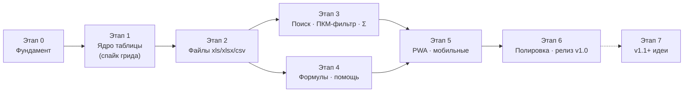
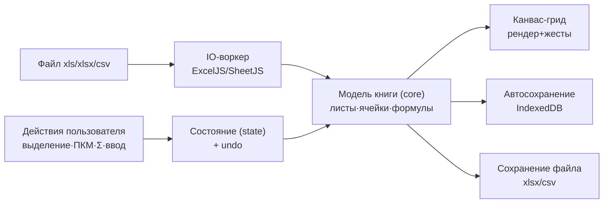

# NovaGrid — Карта создания

Версия: 1.0 (на согласование) · Дата: 2026-10-06

Документ отвечает на вопрос «**что за чем будем делать**». Верхнеуровневые сроки и статусы —
в `ROADMAP.md`; здесь — порядок работ, зависимости и критерии готовности каждого этапа.

---

## 1. Общая карта этапов

Поток данных в приложении (устойчив к замене грида):

Правило движения: **каждый этап заканчивается работающим приложением** (не веткой «на полпути»),
демо пользователю и коротким ревью. Правки согласования вносятся до старта следующего этапа.

## 2. Этапы, задачи и критерии готовности

### Этап 0 — Фундамент (≈ 1 неделя)
**Цель:** согласованная документация + скелет приложения.
- 0.1 Согласование: пользователь читает `docs/`, отвечает на открытые вопросы (CONCEPT.md §6) ✅ *документы готовы — жду согласования*
- 0.2 Репозиторий: git + GitHub remote + CI (Actions: lint/typecheck/test/build) ✅ *CI зелёный (novagrid-003); Pages подготовлен, но заблокирован планом GitHub до решения владельца*
- 0.3 Каркас: Vite + React + TS, ESLint/Prettier, Vitest + Playwright пустые прогоны ✅ *полный каркас (novagrid-004): структура по §6, Vitest 4 юнит, Playwright 4 e2e в CI*
- 0.4 Дизайн-токены (палитра, шрифты self-host), SVG-логотип по макету ✅ *novagrid-004: tokens.css полным набором, переменные woff2 Montserrat/Open Sans, знак «N» из двух стрелок*
- 0.5 Каркас UI: тулбар, строка формул (заглушка), панель листов, статус-бар, стартовый экран ✅ *novagrid-004: все панели по DESIGN-SYSTEM §6, грид-скелет с карточкой-заглушкой*

**Готово, когда:** `npm run dev` показывает каркас в фирменных цветах; CI зелёный; структура папок как в ARCHITECTURE.md §6.

### Этап 1 — Ядро таблицы (≈ 2–3 недели)
**Цель:** быстрый грид с редактированием и выделением (данные пока в памяти, без файлов).
- 1.1 **Спайк (3–5 дней):** свой canvas-grid ⇄ Glide Data Grid; критерии: 60 fps @ 100k×30,
  кастомные жесты (ПКМ/Alt/Ctrl), кириллица/IME, бандл, трудоёмкость → фиксация выбора
  ✅ *собственный canvas-грид — решающий аргумент: Ctrl-несмежные выделения (Ф5) не вписываются в модель GDG; протокол: [SPIKE-1-GRID.md](SPIKE-1-GRID.md)*
- 1.2 Виртуализация: рендер видимых ячеек, стреловая навигация, прокрутка 60 fps
  ✅ *нативная прокрутка (spacer) + канвас-оверлей; кадр рисует ~видимое окно, e2e-замер avg < 16 мс на 100k×30*
- 1.3 Редактирование: ввод/замена, F2, Tab/Enter, Escape-отмена
  ✅ *DOM-редактор поверх канваса (IME/кириллица нативно), клик-во-время-правки фиксирует её*
- 1.4 Выделение: клик, Shift-диапазон, **Ctrl-несмежные массивы**, Ctrl+A, Esc (Ф5)
  ✅ *core/selection — якорные диапазоны, дедупликация пересечений; клик по шапке — колонка/строка*
- 1.5 Undo/Redo (zundo), горячие клавиши, фокус-менеджмент
  ✅ *delta-стек core/history вместо zundo (снимки на 100k ячеек дороги памятью — см. SPIKE-1-GRID §2); Ctrl+Z/Y, Delete, PageUp/Down, Home/End, Ctrl+стрелки; фокус возвращается гриду после правки*
- 1.6 **Проверка Alt-жеста** на Windows/macOS/Linux → выбор финальной механики быстрой суммы (Ф4)
  ✅ *Alt+drag с живой Σ у курсора подтверждён автотестом на Windows/Chromium; липкий Σ — запасной путь (Этап 3); macOS/Linux — в матрице платформ Этапа 5*

**Готово, когда:** e2e-тест водит выделение/редактирование ✅ (8 сценариев `tests/grid.spec.ts`); скролл 100k×30 без просадок ✅ (замер кадра в e2e); решение по гриду и Alt зафиксировано ✅ ([SPIKE-1-GRID.md](SPIKE-1-GRID.md)). *Этап закрыт технически (карточка novagrid-005); демо и ревью согласования — у пользователя.*

### Этап 2 — Файлы (≈ 2 недели)
**Цель:** полный цикл «открыл → правишь → сохранил».
- 2.1 IO-воркер: чтение .xlsx/.xlsm (ExcelJS), .xls (SheetJS), .csv/.tsv (детектор разделителя/кодировки)
  ✅ *src/io: воркер (ленивый чанк ~1.3 МБ с ExcelJS/SheetJS, основной бандл не тронут); CSV-конвейер свой — детектор разделителя по частоте вне кавычек, кодировка: BOM → строгий UTF-8 → Windows-1251*
- 2.2 Внутренняя модель книги + вкладки листов (переименовать/добавить/удалить/дублировать)
  ✅ *core/workbook + store: инвариант «sheet = активная вкладка», имена по правилам Excel (≤31, без \/?*[]:), delta-история undo на вкладку*
- 2.3 Сохранение: .xlsx (стили!), .csv; «Сохранить как…»; прямая запись File System Access; fallback-скачивание
  ✅ *стили xlsx⇄модель⇄xlsx (bold/заливка/выравнивание/цвет — юнит-roundtrip и рендер в канвасе); Ctrl+S/Ctrl+Shift+S; FSA на Chromium, диалог+скачивание на остальных; .xls сохраняется как .xlsx*
- 2.4 Автосохранение сессии (Dexie) + восстановление после краша; стартовый экран «Недавние»
  ✅ *дебаунс 1 с + сброс на pagehide/скрытии вкладки; «Недавние» (8 последних) + «забыть»; книги >150k ячеек не сессируются (заморозка вкладки дороже пользы)*
- 2.5 Фикстуры: демо-книга сценария ТЗ (фамилии+суммы), стресс-файл 100k строк
  ✅ *public/fixtures: demo-book.xlsx (2 листа, ровно 132 строки «Иванов+10 000» под сценарий КТ-3, стили шапки), stress-100k.csv, legacy-demo.xls; генератор scripts/make-fixtures.mjs (детерминированный ГПСЧ)*

**Готово, когда:** демо-файл открывается ≤ 3 с ✅ (e2e-бюджет 3 с на открытие demo-book.xlsx, фактически ~0.5 с), правки сохраняются и переживают переоткрытие ✅ (e2e «открыл→изменил→Ctrl+S→переоткрыл»), e2e «открыл→изменил→сохранил→переоткрыл» зелёный ✅ (tests/files.spec.ts). *Этап закрыт технически (карточка novagrid-006); демо и ревью согласования — у пользователя.*

### Этап 3 — Ключевые фичи ТЗ: поиск · ПКМ-фильтр · Σ (≈ 2 недели)
**Цель:** три главные фичи из промта.
- 3.1 Поиск: инкрементальный, «лист/все листы», подсветка, счётчик, навигация (Ф2)
  ✅ *core/search + панель поиска тулбара: Ctrl+F, подсветка мятным/текущее оранжевой рамкой, счётчик «N / M», Enter/Shift+Enter/F3/▲▼, регистр и «ячейка целиком», список результатов по листам с переходом; скрытые фильтром строки не ищутся (подсветка = видимое)*
- 3.2 Контекстное меню ПКМ: фильтр по значению, добавление значений, инверсия, сброс (Ф3)
  ✅ *ui/ContextMenu: «Фильтровать: A = «Иванов»» / «Исключить: A ≠» / «Добавить к фильтру» / снятие с колонки / сброс всех + копирование ячейки/строки; значение — то, на котором нажали*
- 3.3 Многоколоночная фильтрация по «И» + чипы фильтров + статус «показано N из M»
  ✅ *core/filter: видимые строки недеструктивно (RowLayout в гриде); чипы [A: Иванов ×] под тулбаром, клик по чипу — меню колонки; «Показано 132 из 501» на панели листов; Σ/n/x̄ считают только видимые; фильтры изолированы по вкладкам*
- 3.4 Меню колонки ▾: галочки значений, пустые, сортировка (Ф3+Ф8)
  ✅ *ui/ColumnMenu: сортировка видимых строк (числа числово, пустые в конце, подтверждение при первом использовании, Ctrl+Z), галочки значений с количеством и поиском, «(Пустые)», сброс; воронка в заголовке отфильтрованной колонки*
- 3.5 Большая кнопка Σ + карточка метрик + статус-бар Σ/n/x̄ (Ф4)
  ✅ *ui/SumCard: Сумма/n/заполненные/среднее/мин/макс, клик по строке копирует; статус-бар живой; Alt-лассо дублирует сумму крупно в зоне Σ*
- 3.6 Alt-выделение с живой суммой (или выбранный на 1.6 аналог)
  ✅ *механика 1.6 (Alt+drag): метка у курсора + крупная сумма у кнопки Σ; липкий Σ-режим не понадобился (риск 1 закрыт на Windows/Chromium)*

**Готово, когда:** e2e повторяет сценарий ТЗ: «ПКМ на Иванов в A, ПКМ на 10000 в C → видно 132 строки → Σ показывает сумму». ✅ *tests/features.spec.ts: «Показано 132 из 501», Σ 1 320 000 (132 × 10 000), карточка метрик, чипы, сброс; 96 юнит + 26 e2e зелёные. Этап закрыт технически (карточка novagrid-007); демо и ревью согласования — у пользователя.*

### Этап 4 — Формулы и помощь (≈ 2–3 недели)
**Цель:** свои формулы + помощь, встроенная в момент действия.
- 4.1 Парсер формул + вычислитель (~25 функций, список Ф6) — юнит-покрытие ≥ 80%
  ✅ *src/formula: свой токенайзер+парсер (AST) и вычислитель — 33 функции (Ф6 целиком + SUMIFS); «;» и «,» в аргументах, A1/A:A/$B$2, числа 1,5 и 1.5, джокеры в критериях; покрытие строк движка 96% (vitest --coverage)*
- 4.2 Пересчёт при правках, зависимости диапазонов
  ✅ *инкрементально: delta-правки → формулы с задетыми прямоугольниками зависимостей + транзитивно; циклы — «Циклическая ссылка…»; значения — WeakMap по иммутабельному листу*
- 4.3 Строка формул: показ формулы/значения, живое редактирование
  ✅ *формула активной ячейки видна в строке, правка на месте (Enter фиксирует, Esc отменяет), Σ/поиск/фильтры/статус-бар видят вычисленные значения*
- 4.4 Автодополнение при `=`, подсказки аргументов, ошибки человеческим языком
  ✅ *попап функций по префиксу (строка формул и редактор ячейки), подпись аргументов вызова с текущим; ошибки вида «Не хватает закрывающей скобки», «Диапазон A5:A2 записан снизу вверх — нужно A2:A5» — в ячейке и строке формул*
- 4.5 Справочник «?»: карточки формул с живыми примерами, горячие клавиши, приёмы
  ✅ *HelpDialog (кнопка «?» и F1): карточки всех функций, живой пример считается движком на текущей таблице (пустой — встроенная мини-таблица), поиск, горячие клавиши, приёмы*
- 4.6 Стратегия чужих формул: кэш значений, индикатор «не пересчитывается», сохранение как есть
  ✅ *импорт xlsx: текст формулы + кэш результата Excel; неподдерживаемое показывает кэш с меткой «∛ не пересчитывается» (индикатор в ячейке и строке формул), поддерживаемое пересчитывается; экспорт xlsx пишет {formula, result} (канонические «,»), CSV — значения*
- 4.7 (второй проход) VLOOKUP/DATE-семейство, если вошли в срок
  ✅ *вошли: VLOOKUP (точное по умолчанию + приближённое), DATE/TODAY/YEAR/MONTH/DAY (даты — ISO-строки, как их читает импорт), плюс SUMIFS*

**Готово, когда:** `=SUMIF(...)` считается и пересчитывается; справочник открывается; e2e «ввёл формулу — получил сумму отфильтрованного». ✅ *tests/formulas.spec.ts: ПКМ-фильтр 132 строки → =SUMIFS(C2:C501;A2:A501;"Иванов";C2:C501;10000) → 1 320 000, правка суммы пересчитывает, Ctrl+Z возвращает; строка формул, автодополнение, справочник, чужие формулы (фикстура formula-book.xlsx). 166 юнит + 33 e2e зелёные. Этап закрыт технически (карточка novagrid-008); демо и ревью согласования — у пользователя.*

### Этап 5 — PWA и мобильные (≈ 1–2 недели)
**Цель:** установка и полноценная работа на любом устройстве.
- 5.1 vite-plugin-pwa: офлайн-оболочка, обновление без потери сессии
  ✅ *registerType 'prompt' — precache оболочки (20 файлов), обновление по кнопке, сессия в IndexedDB переживает reload; демо-файлы CacheFirst*
- 5.2 Мобильная раскладка: нижняя панель, длинное нажатие = ПКМ, чипы-лента, крупные метрики
  ✅ *MobileBar (Открыть·Поиск·Σ·?, касания ≥48px), useIsMobile (coarse/<760px), файловые кнопки в «⋯» тулбара; длинное нажатие 500 мс = ПКМ*
- 5.3 Жесты: касание-выделение, пинч-зум таблицы
  ✅ *тач-выделение от активной ячейки, пинч с якорем (zoom-стор + масштаб шрифтов канваса), Ctrl+колесо, −/+ в статус-баре*
- 5.4 Проверка на реальных устройствах/эмуляторах: Android Chrome, iPad Safari
  🟡 *Android-эмуляция Pixel 7 в e2e (сценарий фильтрации касаниями без мыши — tests/matrix.spec.ts); реальные устройства и iPad Safari — демо у владельца (карточка novagrid-009 в blocked до ручной проверки КТ-4)*

**Готово, когда:** Lighthouse PWA ≥ 90; сценарий фильтрации проходится на мобильном экране без мыши.
🟡 *код собран и покрыт e2e (мобильный сценарий без мыши зелёный); Lighthouse ≥ 90 и живые устройства — ручная проверка владельца; итоги и фикс rafRef-бага — журнал карточки 009*

### Этап 6 — Полировка и релиз v1.0 (≈ 1–2 недели)
- 6.1 Производительность: профилирование больших файлов, узкие места
  ✅ *[PERF-REPORT.md](PERF-REPORT.md): все операции на 100k×30 < 100 мс; selectionMetrics 340→45 мс (7.6×), фильтры Set-ом — без деградации от ширины*
- 6.2 Доступность: клавиатура везде, ARIA-грид, контраст-аудит
  ✅ *Shift+F10/клавиша меню — меню ячейки с клавиатуры; паттерн ARIA-menu (автофокус, ↑↓ циклично, Esc, возврат фокуса гриду); живой регион активной ячейки; контраст WCAG AA по всем парам токенов (scripts/contrast-audit.mjs, токены приведены: ink-soft, primary-text/btn, danger-text); 4 e2e*
- 6.3 Локализация en, настройки (шрифт, разделители)
  ✅ *src/i18n: стор настроек (localStorage), ru/en словари, useT() в 16 компонентах, формат чисел за языком; настройки: язык, размер таблицы (масштаб через зум 5.3), разделитель CSV по умолчанию; 3 e2e*
- 6.4 Багфикс по чек-листу матрицы платформ; публикация GitHub Pages; демо-файлы на стартовом экране
  ✅ *матрица: e2e на Chromium + Firefox + WebKit (смок @smoke) + Android-эмуляция Pixel 7 (@mobile), CI ставит все три браузера; сценарий ТЗ 1–3 с (< 1 мин КТ-5); Pages — готовность задокументирована (RELEASE-V1.0.md), включение за владельцем (риск 8); демо-файлы на стартовом экране — с Этапа 2*

**Готово, когда:** все e2e зелёные; «сценарий пользователя из ТЗ» проходится за < 1 минуты на Windows и Android; приложение опубликовано.
✅ *47 e2e зелёные; сценарий ТЗ 1–3 с на десктопе и Android-эмуляции (замер в тесте); публикация — готовность к Pages документирована, включение ждёт решения владельца по плану GitHub ([RELEASE-V1.0.md](RELEASE-V1.0.md))*

### Этап 7 — v1.1+ (после релиза, по обратной связи)
✅ «Найти и заменить» (Ctrl+H) — собрано в v1.1.0 (карточка novagrid-013,
[RELEASE-V1.1.md](RELEASE-V1.1.md)).

Полный план доработки развёрнут карточкой novagrid-014 (пожелание владельца
11.10.2026): карточки 015–019, скорость/приоритет 8, поэтапно — одна карточка =
одна сессия (токены расходуются оптимально, следующий этап не начинается,
пока не закрыт предыдущий):

| # | Этап | Карточка | Версия | Суть |
|---|---|---|---|---|
| 7.2 | Тёмная тема | novagrid-015 | v1.2.0 | токены + «Система/Светлая/Тёмная», prefers-color-scheme, AA-контраст в обеих, канвас без перезагрузки |
| 7.3 | Импорт .ods | novagrid-016 | v1.3.0 | чтение значений в IO-воркере (SheetJS), многостраничность → вкладки; стили не переносятся |
| 7.4 | Печатные формы | novagrid-017 | v1.4.0 | печатный DOM по модели (не канвас), @media print, фильтры учтены, повтор шапки |
| 7.5 | Обёртки | novagrid-018 | — | Tauri 2 (десктоп Windows) — установщик в builds/; Capacitor/Android — при готовой базе; право blocked по тулчейну |
| 7.6 | Облачная синхронизация | novagrid-019 | — | сначала 2–3 приватные схемы на согласование владельцу (Aila «Хаб ИИ»), реализация — после выбора |

На владельце (вне карточек демона): живые устройства Android Chrome / iPad Safari
для КТ-4 (карточка novagrid-009 — код готов, Lighthouse PWA 100/100); включение
GitHub Pages (риск 8 — public/платный план); ответы на CONCEPT §6.1 (имя сайта)
и §6.4 (сохранение .xls через «Сохранить как .xlsx»). Вопросы §6.2 (.ods) и
§6.3 (тёмная тема) закрываются этим планом.

## 3. Первые шаги после согласования (дни 1–5)

| День | Что делаем |
|---|---|
| 1 | Ответы на открытые вопросы (CONCEPT §6) → фиксация решений; GitHub remote + CI |
| 2 | Каркас Vite+React+TS, токены дизайн-системы, шрифты, логотип SVG |
| 3 | Каркас главного экрана (тулбар/листы/статус-бар) по DESIGN-SYSTEM §6 |
| 4 | Старт спайка грида: минимальный canvas-рендер с виртуализацией |
| 5 | Спайк продолжается: ввод и выделение; сравнение с Glide Data Grid, протокол решения |

## 4. Чек-лист согласования (для пользователя)

- [ ] Концепция и функции Ф1–Ф9 (docs/CONCEPT.md) — верно поняты?
- [ ] Анти-скоуп (§5) — согласны, что этого не делаем в v1?
- [ ] PWA как платформа (docs/ARCHITECTURE.md §1) — устраивает?
- [ ] Поведение формул (чужие — кэш значений, свои — движок) — ок?
- [ ] Alt-выделение и запасной «липкий Σ-режим» — ок?
- [ ] Ответы на открытые вопросы 1–5 (CONCEPT.md §6)
- [ ] Дизайн: палитра/шрифты/раскладки (docs/DESIGN-SYSTEM.md) — соответствуют макету?
- [ ] Этапы и порядок (§2) — согласованы? Стартуем с Этапа 0?

*Согласование можно давать целиком или по документам — любое удобнее.*
